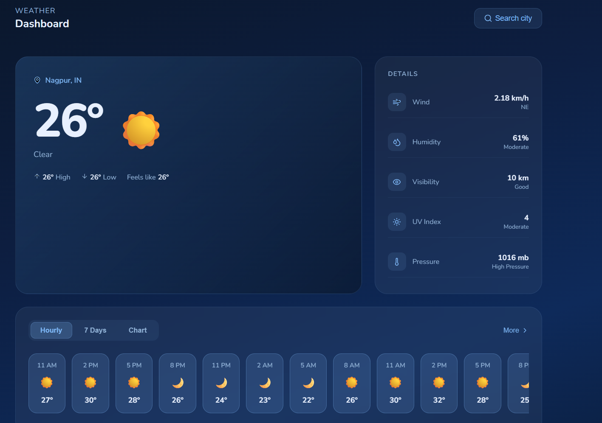

# 🌤️ Weather App

A modern, interactive weather dashboard built using **Vanilla JavaScript**, **HTML**, and **CSS**.  
It provides real‑time weather updates with a clean, minimal UI and smooth data visualization.

---

## 📸 Screenshot



---

## 🚀 Features

- 🔍 **Search functionality** — find weather details for any city worldwide.  
- 🌡️ **Detailed metrics** — temperature, humidity, wind speed, pressure, UV index, and visibility.  
- 📅 **Hourly & 7‑day forecast** — view upcoming weather trends.  
- 📊 **Interactive charts** — visualize temperature changes over time.  
- 💎 **Responsive design** — optimized for desktop and mobile screens.  

---

## 🧠 Tech Stack

| Technology | Purpose |
|------------|----------|
| HTML       | Structure |
| CSS        | Styling and layout |
| JavaScript (Vanilla) | API calls, dynamic rendering |
| OpenWeather API | Weather data source |

---

## ⚙️ Setup Instructions

1. Clone the repository:
   ```bash
   git clone https://github.com/sarvesh-webdev/weather-app.git
